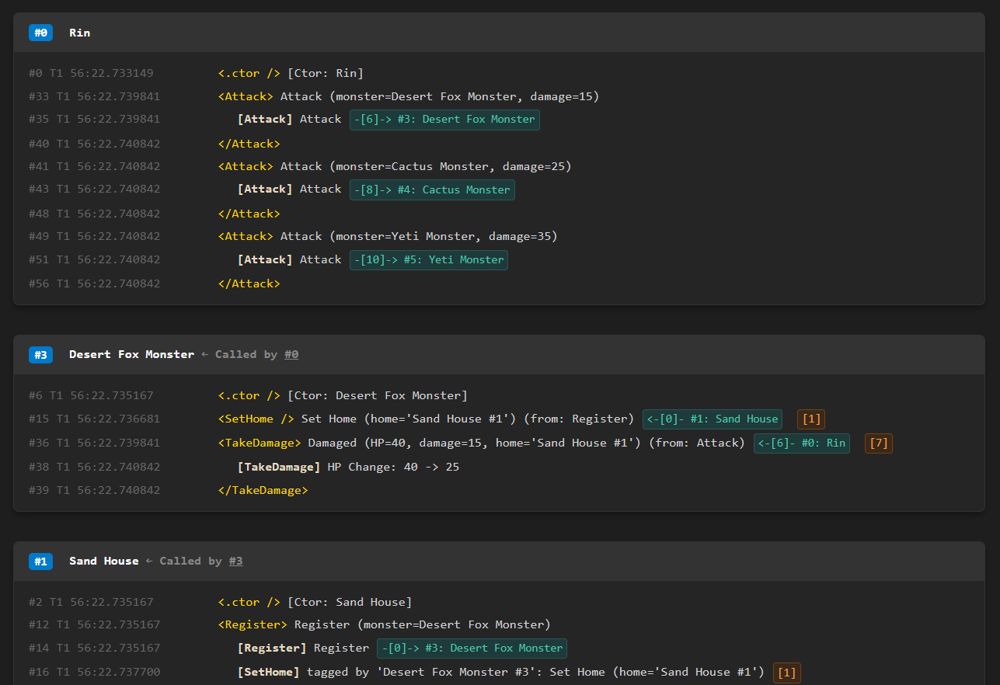

# Blackbox System

[한국어](README.ko.md)

Blackbox is a .NET tracing framework for recording object activity, execution scopes, and object-to-object interactions, then reading them later as connected logs.

Where a normal log focuses on a message at one moment, Blackbox records both 'what process this object went through' and 'which objects were connected during that process'.



## Before You Start

Blackbox is a foundational tracing framework in the BlackThunder project family.

If you find a problem or have a suggestion, please open a [Discussion](https://github.com/dove-creative/blackbox-system/discussions) or contact vkdl4062@gmail.com. Thank you for using Blackbox.

## Features

- Per-object log storage: creates a `Blackbox` for each target object and accumulates logs during execution.
- Scope records: records the start and end of processing ranges with `Scope(...)` and `using`.
- Interaction records: records object-to-object call relationships on both sides with `Exert(...)` and `ExertMessage(...)`.
- Tag links: attaches related targets to the source log with `Write(...).With(...)` or `Scope(...).With(...)`.
- Export: writes recorded logs to text or HTML files.
- Runtime switch: set `BlackboxHandle.UseBlackbox` to control whether recording handles are created and logs are written.

## Requirements and Installation

Consumers reference a pinned stable release of `BlackThunder.BlackboxSystem`. Register the directory containing the released `.nupkg` as a NuGet feed before restoring it.

```powershell
dotnet add package BlackThunder.BlackboxSystem --version "[0.2.0]"
```

You can also add the reference directly to the project file.

```xml
<ItemGroup>
  <PackageReference Include="BlackThunder.BlackboxSystem" Version="[0.2.0]" />
</ItemGroup>
```

Samples in the Blackbox development repository use a `ProjectReference` to the current library project. The runtime library has no dependency on UniTest.

Building this repository and running its tests, samples, or benchmarks requires a .NET 10 SDK. The library targets `netstandard2.1`, executable projects target `net10.0`, and the language version is C# 9. See the [contribution guide](CONTRIBUTING.md) for shared-guideline submodule initialization and development rules.

Configure the log output location and logger early in execution.

```csharp
BlackboxHandle.Configure(
    logDirectory: Path.Combine(AppContext.BaseDirectory, "BlackboxLogs"),
    logger: Console.WriteLine);
```

Recording starts enabled by default. To temporarily stop recording, set `BlackboxHandle.UseBlackbox = false` or pass `useBlackbox: UseBlackboxOption.DoNotUse` to `Configure(...)`. When this switch is off, `BlackboxHandle.Of(subject)` returns an invalid handle and recording calls fall back to no-op/default behavior.

C# 9 callers use string overloads for interpolated messages, so expressions inside the string are evaluated first even when recording is disabled. Automatic short-circuiting through `WriteHandler` is supported for callers compiled with C# 10 or later.

## Quick Start

### Basic Usage Code

```csharp
using BlackThunder.BlackboxSystem;

public class Loader
{
    public Loader()
    {
        using var scope = BlackboxHandle.Of(this, label: "Loader").Construct();
    }

    public void Load(Worker worker)
    {
        using var _ = BlackboxHandle.Of(this).Scope("Load");

        BlackboxHandle.Of(this).Write("Prepare %0").With(worker);

        using (BlackboxHandle.Of(this).Exert(worker, "Worker.Load"))
        worker.Load();
    }

    public void ExportLogs() => BlackboxHandle.Of(this).Export();
}
```

This example records the following information.

- The `Load` scope of the `Loader` object
- The scope-start log
- Bidirectional interaction records for the `worker.Load()` call
- Connected log output centered on `Loader` when `ExportLogs()` is called

### C# Sample

Use the [console sample in samples](samples/README.md) to exercise the recording flows.

```powershell
dotnet run --project samples/BlackThunder.BlackboxSystem.Samples.csproj
dotnet run --project samples/BlackThunder.BlackboxSystem.Samples.csproj -- write
```

The first command opens the `sample>` prompt for repeated runs of `write`, `exert`, `tag`, or `exception`. The second command runs the `write` scenario once and exits without opening a browser.

Logs are written to scenario-specific folders under the executable output directory. The `write` scenario uses `SampleOutput/Write`. See the [sample documentation](samples/README.md) for command usage, exit codes, and export-opening behavior (Korean).

## Main APIs

- `BlackboxHandle.Of(subject, label: name)`: gets the recording entry point for the target object in the current session, with an optional label.
- `Write(message)` / `WriteError(message)`: records activity or errors.
- `Scope(message)`: records the execution scope of a `using` block.
- `Exert(other, message)` / `ExertMessage(other, message)`: records object-to-object interactions in both objects' logs.
- `With(targets)`: attaches related targets to an activity log or scope-start log.
- `Export(...)` / `CrashExport(...)`: exports connected logs, optionally recording an error as part of the export.
- `BlackboxHandle.BeginSession()`: begins a test/debug session with its own lifetime.
- `BlackboxHandle.RestartDefaultSession()`: ends and replaces the shared default session while preserving its settings.

See [Usage](docs/Wiki/04-Usage.md) for calling guidelines and the [session and recording contract](docs/Wiki/05-Sessions.md) for disposal and leak diagnostics (Korean).

## Documentation

- [Overview](docs/Wiki/01-Overview.md): purpose and main recording structures (Korean)
- [Usage](docs/Wiki/04-Usage.md): configuration and representative workflows (Korean)
- [Implementation](docs/Wiki/02-Implementations.md): component responsibilities and recording pipelines (Korean)
- [Session and recording contract](docs/Wiki/05-Sessions.md): lifecycle, default sessions, lock-free recording, and exports (Korean)

## Tests

Run both NUnit test projects with a .NET 10 SDK. The main project covers recording, handles, exports, and samples. The C# 10 project checks that interpolated messages bind to `WriteHandler` and skip formatted expressions when recording is disabled.

The root `NuGet.config` restores `BlackThunder.UniTest` `0.4.0` from the checked-in `packages/` local feed and third-party dependencies from nuget.org.

```powershell
dotnet test tests/BlackThunder.BlackboxSystem.Tests/BlackThunder.BlackboxSystem.Tests.csproj
dotnet test tests/BlackThunder.BlackboxSystem.Tests.CSharp10/BlackThunder.BlackboxSystem.Tests.CSharp10.csproj
```

See the [contribution guide](CONTRIBUTING.md) for verification scope and development settings, along with the [session validation report](docs/Tests/04-Sessions.md) and [recording benchmark](benchmarks/README.md).

## License

Blackbox is distributed under the MIT license. See [LICENSE.md](LICENSE.md) for details.
