# Blackbox 객체 다이어그램

> 이 문서는 C# 구현을 설명한다. TypeScript 사용법과 런타임별 계약은 [TypeScript 안내](../../typescript/README.md)를 따른다.

이 다이어그램은 Blackbox의 핵심 기록 경로에 참여하는 객체와 관계를 보여준다. 저장소와 기록 카운터는 세션마다 독립적이다. BlackboxHandle.RestartDefaultSession()은 공유 기본 세션만 교체하며, 명시적 세션은 Dispose 후 Begin으로 새로 시작한다.

```mermaid
classDiagram
direction TB

class Blackbox {
  +object Owner
  +string OwnerString
  +long Id
  ~SessionState State
  -ContextNode contexts
  -long scopeId
  +Write(message, methodName)
  ~Tag(message, methodName, taggedBy, interactionId, tags, targetTypes)
  +Scope(message, methodName)
  +ExertMessage(other, message, methodName)
  +Exert(other, message, methodName)
  +GetLogsByContext(maxSequence)
  +GetLogs(maxSequence)
}

class BlackboxSession {
  +Guid SessionKey
  ~SessionState State
  ~SubjectStore Subjects
  -HandleTracker[] trackers
  +Dispose()
  ~OpenScope(box, message, methodName)
  ~Exert(source, target, message, methodName)
}

class SessionState {
  ~SessionSettings Settings
  ~CrashInfo Crash
  ~bool IsActive
  ~long CurrentSequence
  ~NextBoxId()
  ~NextInteractionId()
  ~NextSequence()
  ~TryDeactivate()
  ~TryFreeze(crash)
  ~TryUpdateSettings(update)
  ~TryMarkWarned(reason)
}

class BlackboxSessionRegistry {
  <<static>>
  -List~BlackboxSession~ ActiveSessions
  -object ActiveSessionsLock
  ~BlackboxSession Current
  ~BlackboxSession Default
  ~Guid CurrentKey
  ~Guid DefaultKey
  ~int ActiveSessionCount
  ~GetActiveSessionKeys() Guid[]
  ~DisposeActiveSessions()
  ~Begin(buckets)
  ~Remove(session)
  ~Restore(session, previous)
  ~RestartDefaultSession()
  ~GetBlackbox(subject)
  ~Contains(subject)
  ~Count()
}

class LogContext {
  -LogData[] logBuffer
  -long currentLogIndex
  -int threadId
  -string threadName
  -List~ScopeInfo~ openScopes
  +OpenScope(message, sequence, methodName, scopeId)
  +CloseScope(scopeId, sequence)
  +EnqueueLog(message, sequence, methodName, scopeId, interactionId)
  +EnqueueTagLog(message, sequence, methodName, interactionId)
  +ResolveWith(logIndex, tags, targetTypes)
  +RenderMessage(logIndex, fallbackMessage)
  +TryMergeScope(interactionId)
  +GetLogs(maxSequence)
}

class LogData {
  +Blackbox Owner
  +bool IsValid
  +string Message
  +DateTime Time
  +int ScopeDepth
  +long Sequence
  +string MethodName
  +long ScopeId
  +ScopeType ScopeType
  +int ThreadId
  +string ThreadName
  +Blackbox ExertedBy
  +Blackbox ExertingTo
  +long InteractionId
  +Blackbox TaggedBy
  +TargetTypes TagTargetTypes
  +Tag[] Tags
  +ToString(scopeDepth)
}

class LogFormatter {
  <<static>>
  +RenderMessage(log)
  +RenderTextLine(log, scopeDepth)
  +RenderMethodLabel(log)
  +ObjectRef(blackbox)
  +TagRef(blackbox, interactionId)
  +Arrow(right, interactionId)
}

class BlackboxHandle {
  -Blackbox blackbox
  -BlackboxSession session
  +object Owner
  +string OwnerString
  +long Id
  +bool IsValid
  +Of(subject)
  +Configure(...)
  +BeginSession()$
  +Guid CurrentSessionKey$
  +Guid DefaultSessionKey$
  +int ActiveSessionCount$
  +GetActiveSessionKeys() Guid[]$
  +DisposeActiveSessions()$
  +RestartDefaultSession()
  +Construct(message, out handle)
  +When(condition)
  +Dispose(message)
  +Write(message, methodName)
  +Scope(message, methodName)
  +ExertMessage(other, message, methodName)
  +Exert(other, message, methodName)
  +WriteError(message, others)
  +CrashExport(message, others)
  +Export(...)
}

class ScopeType {
  <<enum>>
  None
  Open
  Close
  Step
}

BlackboxSessionRegistry --> BlackboxSession : 현재·기본 세션 조회
BlackboxSessionRegistry --> "0..*" BlackboxSession : 활성 명시적 세션 강한 참조
BlackboxSession *-- SessionState : 세션 데이터 소유
BlackboxSession *-- Blackbox : SubjectStore로 owner별 기록 엔진 보유
Blackbox --> SessionState : 소속 세션의 기록 가능 여부·번호·설정 사용
Blackbox *-- LogContext : 스레드별 문맥 보유
LogContext *-- LogData : 로그 버퍼 보유
LogContext --> ScopeType : 스코프 열기/닫기 기록
LogData --> ScopeType : 로그 종류 분류
LogData --> Blackbox : owner와 상호작용 상대 참조
LogData ..> LogFormatter : 출력 문자열 생성 위임
BlackboxHandle --> BlackboxSessionRegistry : 세션 시작·조회·활성 세션 정리 위임
BlackboxHandle --> Blackbox : 기록 호출 전달
BlackboxHandle --> BlackboxSession : 대상 조회·핸들 등록·출력
```

활성 목록에는 기본 세션과 재시작 후보를 넣지 않는다. 세션 시작·종료·활성 목록 조회만 잠금을 사용하며 기록·등록 경로는 무잠금이다. 일괄 종료는 스냅샷을 잠금 밖에서 시작 역순으로 Dispose하고 다른 실행 흐름의 바인딩은 바꾸지 않는다.

## 다이어그램 제외 항목

가독성을 위해 `TagHandle`, `ScopeHandle`, `ExertHandle`, `HandleManager<T>` 같은 핸들 계열 보조 구조는 이 다이어그램에서 제외한다. `.With(...)`로 연결한 대상 기록은 `LogContext.ResolveWith(...)`가 원본 로그의 태그 목록을 확정한 뒤, `Blackbox.Tag(...)`를 통해 대상 쪽 태그 로그를 추가하는 흐름으로 처리한다.
